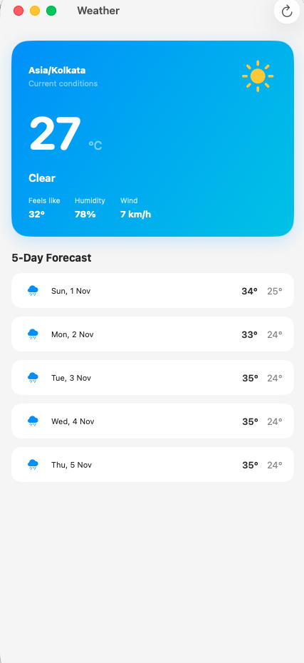

# Weather iOS App

A native SwiftUI weather app that shows current conditions and a five-day forecast for the user’s location.

## Features

- Current temperature, condition, humidity, wind, and feels-like temperature
- Five-day forecast
- Core Location permission handling
- Refresh and retry states
- Open-Meteo weather data over HTTPS

## Architecture

The app uses feature-first Clean Architecture with SOLID-oriented dependency inversion. The structure follows the same flow as a Flutter Clean Architecture feature, using SwiftUI-native `@Observable` state and Swift concurrency instead of BLoC:

```text
App/
├── Core/
│   ├── Constants/                  Shared API configuration
│   ├── DI/                         Composition root
│   └── Network/                    Reusable HTTP client abstraction
├── Features/Weather/
│   ├── Data/
│   │   ├── DataSources/             Location and weather API services
│   │   ├── Models/                  API response types
│   │   ├── Mappers/                 DTO-to-domain conversion
│   │   └── RepositoryImpl/          Concrete repository implementation
│   ├── Domain/
│   │   ├── Entity/                  Business models
│   │   ├── Repository/              Repository and location abstractions
│   │   └── UseCase/                 Application actions
│   └── Presentation/
│       ├── ViewModel/               @Observable presentation state
│       ├── Screens/                 Feature screens
│       └── Widgets/                 Reusable SwiftUI views
└── MyApp.swift                      App entry point
```

The data flow is:

```text
WeatherScreen
    → WeatherViewModel
    → FetchWeatherUseCase
    → WeatherRepository
    → WeatherRepositoryImpl
    → WeatherDataSource
    → APIClient
```

The Domain layer has no API or UI dependency. Data implementations satisfy Domain protocols, and the composition root injects concrete dependencies into the ViewModel. Shared URLSession behavior belongs in `Core/Network`; feature-specific endpoints remain inside the feature data source.

## Requirements

- Xcode 26 or later
- macOS 26 or later for the current project target
- Location Services enabled for the app

The project uses the Open-Meteo API and does not require an API key.

## Screenshots

### Weather dashboard


